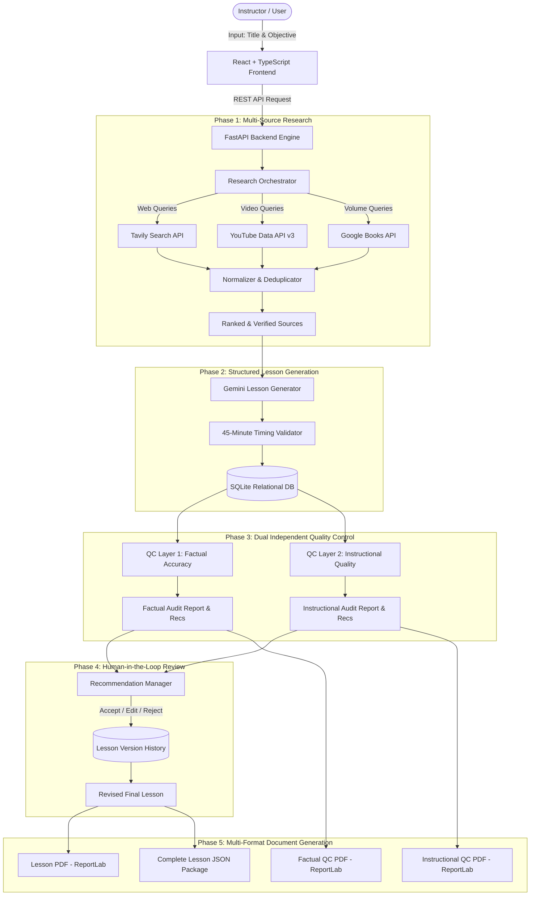

# System Architecture & Technical Specifications

## AI-Powered Lesson Creation & Research Platform
### Kalvium – AI Research Intern Technical Evaluation

---

## 1. Architectural Philosophy

The AI-Powered Lesson Creation & Research Platform is engineered as a decoupled, evidence-grounded educational intelligence system. Rather than relying on naive single-shot LLM prompting, the architecture enforces:
1. **Multi-Source External Retrieval**: Active synthesis of live web, video, and textbook material before generation.
2. **Pedagogical Constraints**: Dynamic enforcement of the strict 45-minute lesson consumption limit.
3. **Dual Independent Quality Control**: Layer 1 (Factual Accuracy & Research Integrity) and Layer 2 (Instructional Quality & Pedagogical Flow) operate with independent prompt templates, evaluation rubrics, audit scores, and PDF audit reports.
4. **Human-in-the-Loop Governance**: Full instructor autonomy to review, accept, reject, edit, and apply recommendations with persistent version snapshotting.

---

## 2. High-Level System Pipeline

---

## 3. Component Breakdown

### 3.1 Research Orchestrator (`app/research/orchestrator.py`)
- **Query Synthesis**: Formulates tailored queries targeting official standards (RFCs, MDN, Scikit-Learn docs) for web search, visual explanations for YouTube, and academic textbook entries for Google Books.
- **Concurrent Execution**: Executes parallel searches across providers via `asyncio.gather`.
- **Attribution & Accessibility Distinction**: Clearly discriminates between full-text web references and Google Books previews/metadata (`is_accessible: False` for previews).
- **Deduplication & Authoritative Boost**: Boosts domain scores for `.edu`, `.gov`, `.org`, and recognized open-source documentation portals.

### 3.2 AI Lesson Generator (`app/ai/lesson_generator.py`)
- **Model**: Google Gemini (`gemini-2.5-flash` or configured via `GEMINI_MODEL`).
- **Structured Schema**: Produces 11 core pedagogical sections:
  1. Introduction
  2. Prerequisite Knowledge
  3. Key Concepts
  4. Detailed Explanations
  5. Practical Examples
  6. Real-World Applications
  7. Hands-on Activities
  8. Knowledge Check Questions
  9. Summary
  10. Additional Learning Resources
  11. References
- **45-Minute Timing Guarantee**: Evaluates reading speed (~150 wpm) and interactive exercise time. Re-normalizes section minutes proportionally so that the sum of all sections strictly satisfies $\sum t_i \le 45\text{ minutes}$.

### 3.3 Quality Control Layer 1: Factual Accuracy (`app/ai/factual_qc.py`)
- **Focus**: Pure technical correctness, claims verification, source citation grounding, and identifying unsupported statements.
- **Output**: Structured audit with severity levels (`LOW`, `MEDIUM`, `HIGH`, `CRITICAL`), original statements, explanations, supporting evidence citations, and recommended text replacements.

### 3.4 Quality Control Layer 2: Instructional Quality (`app/ai/instructional_qc.py`)
- **Focus**: Pedagogical effectiveness, learning objective alignment, explanation clarity, cognitive scaffolding, example relevance, and 45-minute timing feasibility.
- **Output**: Multi-dimensional score across 7 pedagogical vectors with targeted structural recommendations.

### 3.5 Recommendation Manager (`app/services/qc_service.py`)
- Instructors can review each recommendation, modify the proposed text, and apply it with one click.
- Applying a recommendation directly updates the target section and logs an immutable `LessonVersion` snapshot to prevent accidental data loss.

### 3.6 PDF Generation (`app/exporters/`)
- Powered by ReportLab.
- Employs a custom `NumberedCanvas` for professional two-pass header/footer pagination.
- Produces clean tabular layouts, syntax-highlighted code containers, and distinct audit reports for both QC layers.

